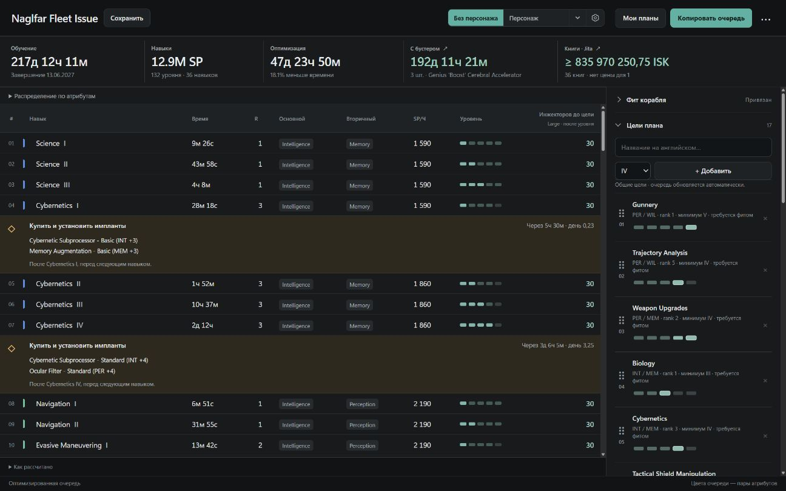

# Skilly

Локальный планировщик навыков EVE Online на Rust с десктопным интерфейсом Tauri для Windows.



## Возможности

- Планы с нуля, импорт EFT-фитов, библиотека фитов и поиск в установленной Pyfa. Окно фита показывает компактный состав и отдельный редактор EFT; импорт и загрузка требований сопровождаются индикатором прогресса.
- Защита обязательных навыков и уровней; сортировка целей перетаскиванием.
- Группы планов с общей оптимизированной очередью.
- Автоматический выбор порядка обучения, neural remap и покупок учебных имплантов с учётом Cybernetics.
- Два приоритета внутри групп атрибутов: быстрее освоить привязанный фит или отложить дорогие книги по ценам Jita. Для плана без фита первый режим раньше завершает короткие цели. Зависимости, границы remap и установок имплантов сохраняются, общий срок обучения не увеличивается. Порядок расходов эвристический; неизвестные цены не считаются нулевыми.
- Подключение персонажей через EVE SSO: отдельные адаптации по навыкам, атрибутам и установленным имплантам. Общий план остаётся независимым.
- Расчёт cerebral accelerators и skill injectors с учётом порогов общего количества SP.
- Стоимость книг по ценам Jita и отметки покупки/изучения перед первым уровнем нового навыка. Открытые навыки персонажа исключаются.
- Клик по строке навыка выделяет её, Shift+клик — диапазон, Ctrl+клик — отдельные строки; Ctrl+C копирует только выбранные уровни в порядке очереди. Ctrl+C в полях ввода работает как обычно.
- Сохранение планов, экспорт JSON и копирование всей очереди.

Если быстрый вариант предлагает уйти с текущего remap и затем вернуться к нему, персональная очередь по умолчанию сохраняет один remap. В настройках показаны оба срока и точная экономия; дополнительный remap можно включить отдельным чекбоксом. Выбор сохраняется для каждого персонажа.

Оптимизация запускается автоматически. Расчёт предполагает Omega; проверяются требования навыков, а не совместимость модулей или CPU/PG фита. Будущие годовые восстановления remap не моделируются. Оптимизатор учитывает время обучения Cybernetics и может отказаться от покупки имплантов, если она не сокращает очередь. Выбор порядка навыков эвристический; глобальный оптимум не гарантируется.

## Скачать

[**Скачать последнюю версию для Windows**](https://github.com/mr-moon/eve-skilly/releases/latest)

Приложение и установщик находятся в [GitHub Releases](https://github.com/mr-moon/eve-skilly/releases).

- `Skilly_<версия>_x64-setup.exe` — установщик Windows x64.
- `Skilly_<версия>_x64.exe` — приложение без установщика.

Нужен Microsoft Edge WebView2 Runtime. Установщик предлагает установить его при отсутствии. Для ESI и рыночных цен требуется интернет.

Пользовательские данные хранятся в `%USERPROFILE%\.skilly\data`. Для резервной копии закройте приложение и скопируйте эту папку. Для отдельного профиля можно передать `--data-dir C:\MySkillyData`.

## Разработка

Требуются Rust, Node.js, MSVC Build Tools, Windows SDK и WebView2.

```powershell
npm ci
npm run desktop:dev
```

Сборка приложения и NSIS-установщика:

```powershell
npm run desktop:build
```

Результаты: `target/release/skilly-desktop.exe` и `target/release/bundle/nsis/Skilly_<версия>_x64-setup.exe`.

Обычная сборка оставляет только актуальные EXE/установщик и удаляет кэш компилятора после успешной сборки. Поэтому следующая сборка компилирует зависимости заново и идёт дольше. Данные и резервные копии профилей не затрагиваются; файлы запущенных приложений сохраняются до их закрытия.

```powershell
# Быстрая повторная сборка: сохранить кэш Rust, убрать старые установщики и EXE.
npm run desktop:build:cached

# Освободить накопившееся место без новой сборки.
npm run clean:builds
```

Debug/test-профили отключают отладочные символы и incremental-кэш для уменьшения размера. Очистка проверяет наличие последней версии и ограничена каталогами артефактов внутри `target/`.


Проверки:

```powershell
npm run test:ui
cargo test --workspace
```

Браузерный режим для разработки:

```powershell
cargo run -p skilly -- --no-open --data-dir target/dev-profile
```

Адрес локального сервера выводится в терминал.

## EVE SSO

Зарегистрируйте собственное приложение на [EVE Developers](https://developers.eveonline.com/). Настройка callback и scopes описана в интерфейсе подключения персонажа. Public Client ID можно указать в приложении или локальном `.env` по образцу `.env.example`. Секрет клиента не требуется.

`.env`, пользовательские планы, снимки персонажей, токены и кэши не входят в репозиторий.

## EXE-релизы через gh

Бинарники прикрепляются к GitHub Release как assets, а не коммитятся в Git. После сборки и отправки исходников создайте черновик релиза:

```powershell
$version = (Get-Content package.json | ConvertFrom-Json).version
gh release create "v$version" --repo mr-moon/eve-skilly --target main --draft --title "Skilly $version" --notes "Описание изменений" "target/release/skilly-desktop.exe" "target/release/bundle/nsis/Skilly_${version}_x64-setup.exe"
```

Прикрепить дополнительный файл к существующему релизу:

```powershell
gh release upload v0.10.10 .\path\to\file.exe --repo mr-moon/eve-skilly
```

Опубликовать проверенный черновик:

```powershell
gh release edit v0.10.10 --repo mr-moon/eve-skilly --draft=false
```

## Лицензия

[MIT](LICENSE). EVE Online и связанные названия принадлежат CCP Games. Skilly — независимый проект и не связан с CCP Games. Сведения о каталоге бустеров: [assets/README.md](assets/README.md).
